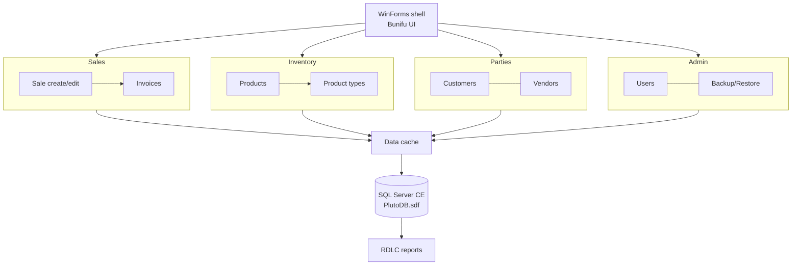

<div align="center">

# 🧾 Pluto Lite

**Lightweight point-of-sale for small shops — sales, invoices, stock, customers, vendors and expenses in one offline desktop app.**

[](https://github.com/mr-aybee/pluto-lite/actions/workflows/ci.yml)


[](LICENSE)

</div>

---

## Overview

Pluto Lite is a Windows desktop POS built for small retailers that need to run without a server. It covers the full counter workflow — products, sales and invoices — plus customer and vendor ledgers, expenses, reporting and backups, all stored in a local SQL Server Compact database.

## Features

- 🛒 **Sales** — create, edit and report; optional SMS receipts
- 🧾 **Invoices** with print-ready views
- 📦 **Products & categories** with stock reports
- 👥 **Customers & vendors** with payment records and balances
- 💸 **Expenses** tracking
- 📊 **Dashboard** and RDLC reports
- ⚙️ **Settings** — users, bill layout, backup & restore, updates

## Architecture



## Tech stack

| Layer | Technology |
| --- | --- |
| UI | C# · Windows Forms · Bunifu UI |
| Runtime | .NET Framework 4.8 |
| Storage | SQL Server Compact (`.sdf`) |
| Reports | Microsoft RDLC |

## Getting started

### Prerequisites

- Windows with .NET Framework 4.8
- Visual Studio 2019+ (.NET desktop development)
- SQL Server Compact 4.0 runtime

### Build

```shell
git clone https://github.com/mr-aybee/pluto-lite.git
cd pluto-lite
nuget restore "pluto-lite/POS mini.sln"
msbuild "pluto-lite/POS mini.sln" /p:Configuration=Release
```

## Usage

1. Launch the app; it opens with `PlutoDB Empty.sdf` as a clean starting database (keep a copy of the empty file).
2. Add users and bill settings under **Settings**.
3. Create product types and products.
4. Record sales from **Sales → Create**; print or reprint from **Invoices**.
5. Track customer/vendor payments and expenses; use **Reports** and the **Dashboard** for totals.
6. Back up regularly from **Settings → Backup & Restore**.

The full walkthrough is in the [user guide](pluto_how-to-use.docx).

## Project structure

```text
pluto-lite/
├── pluto_how-to-use.docx
└── pluto-lite/
    ├── POS mini.sln
    ├── PlutoDB*.sdf             # Empty, schema and sample databases
    └── POS mini/
        ├── FormControls/        # Sales, Products, Customers, Vendors, Expenses, Settings…
        ├── Reports/             # RDLC report definitions
        └── App_Code/            # Data access and caching
```

## Development

- Open `pluto-lite/POS mini.sln` in Visual Studio and build.
- CI builds the solution on Windows for every push and pull request.
- Use the empty database for testing; never commit real customer data.

## Contributing

Contributions are welcome. Read [CONTRIBUTING.md](CONTRIBUTING.md) for the branch, build and pull-request workflow. Please report security issues privately through [GitHub security advisories](https://github.com/mr-aybee/pluto-lite/security/advisories/new), not public issues.

## Code of Conduct

This project follows the [Contributor Covenant](CODE_OF_CONDUCT.md). By participating you agree to uphold it.

## License

Released under the [MIT License](LICENSE). © 2026 Abdullah Shahid.
